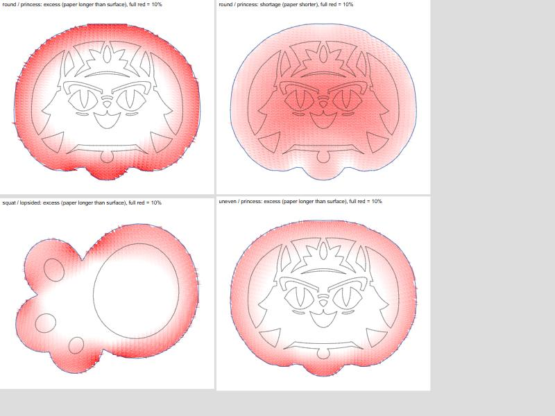
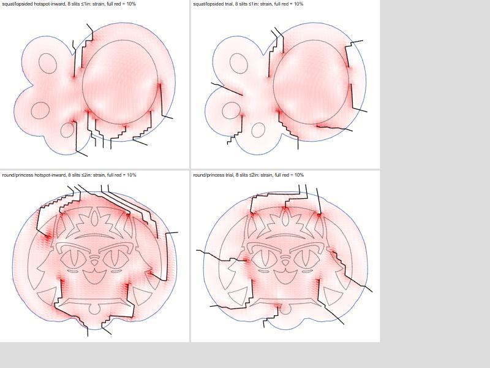
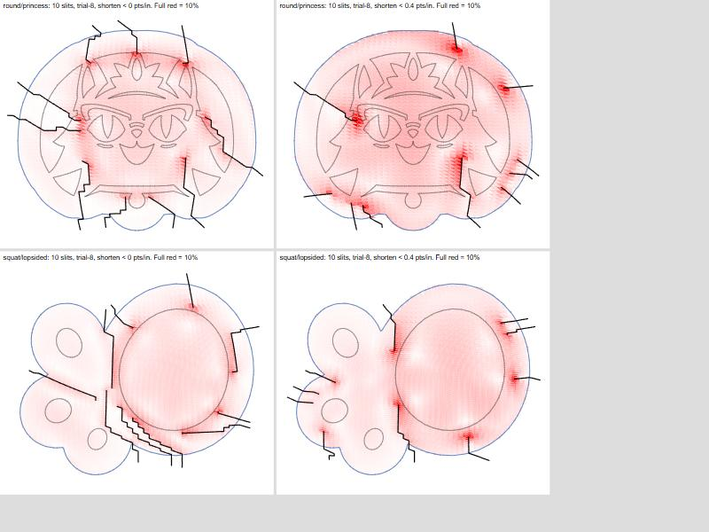

# Slit placement: what relieves strain

Spike for [#34](https://github.com/Carigon/sphereprojection/issues/34), run on 2026-10-19. It answers how strain relates to slit position, depth and count, so the stretch-driven placement rules come from measurements instead of guesses.

## Setup

A throwaway harness ran the real pipeline (fitted surface, projection, cut-out region, refined mesh, ARAP) up to the uncut paper mesh. From there it cut any chosen slits and solved again. Strain is measured per triangle on the paper (inside the cut-out edge) from the singular values σ1 ≥ σ2 of the surface → paper map:

- **excess** `σ1 − 1`: the paper is longer than the surface, so it bunches when wrapped
- **shortage** `1 − σ2`: the paper is shorter, so it has to stretch
- **strain**: the app's existing combined measure `max(σ1, 1/σ2) − 1`, summarised as an area-weighted rms and a 95th percentile (p95)

The maximum is left out: it sits on single triangles at slit tips and depends on how finely the tip is meshed.

| Pumpkin | Measurements |
|---|---|
| round | height 9 in, circumference 30 in at the middle |
| squat | height 6.5 in, circumference 36 in at 0.45 |
| uneven | height 10 in, circumferences 31 / 26 / 18 in at 0.35 / 0.65 / 0.85 |

| Design | Width (front view) |
|---|---|
| princess (`princess_donut.svg`) | 6 in |
| dots: a ring of 8 dots plus one in the middle | 5.8 in |
| lopsided: a big circle on the right, small ones on the left | 5.2 in |

A full solve takes about 60–200 ms in Node for meshes of 4,500–10,700 triangles.

## Findings

### 1. Without slits: too long at the rim, too short in the middle

Flattening a dome works out a compromise. The paper is too long around the rim and too short in the middle. Excess peaks at the cut-out edge (4–10 %) and is gone by 1–1.5 in inward. Shortage grows toward the middle (3–8 %). The squat pumpkin is the worst case (rms 6–7 %) and the uneven one the mildest (1.6–3 %). On irregular shapes the excess concentrates in outlying lobes and corners.

### 2. Slits relieve both kinds of strain

Every slit lowered excess and shortage by similar amounts. For example, the round princess with 8 slits went from excess rms 3.11 → 1.28 and shortage 3.41 → 0.99. Once the rim is free to spread, the middle no longer gets squeezed. **So the existing combined measure works as the objective.** A signed measure isn't needed for choosing slits. It's only useful for explaining the maps.

### 3. Local strain doesn't predict where a slit helps

For one 1 in slit at 24 positions, the correlation between the rim excess at its start and its gain was −0.09 (round princess) and 0.22 (squat lopsided). The one high value, 0.81 on squat dots, came from slits blocked by a dot: they couldn't go deep, so they did nothing.

As greedy strategies, these heuristics did no better than even spacing:

- **"Start at the worst rim excess, run inward"** matched even spacing or did worse. Its slits cluster where the excess is.
- **"Aim at the worst strain anywhere"** failed outright. The worst strain sits in the middle under the design, where no slit can reach.

**Only trying candidates beat even spacing.** That means: for each new slit, cut each of N candidates around the edge, solve, and keep the one with the lowest strain rms. It beat even spacing by 5–16 % at the same depth and count.

| rms % at 8 slits | Even | Rim hotspot | Trial (16 candidates) |
|---|---|---|---|
| round/princess, ≤1 in | 2.70 | 2.79 | **2.55** |
| round/princess, ≤2 in | 1.81 | 2.01 | **1.56** |
| squat/lopsided, ≤1 in | 1.66 | 1.79 | **1.55** |
| squat/dots, ≤1 in | 3.61 | 3.67 | **3.19** |
| uneven/princess, ≤2 in | 1.08 | 1.35 | **0.91** |

### 4. Depth matters far more than position: spend the cut on a few long slits

A single slit's gain grows roughly linearly with depth, with no knee, until blank paper runs out. Slits of 0.5 in or less do almost nothing.

| Mean rms gain (pct points), one slit, by depth | 0.25 | 0.5 | 0.75 | 1 | 1.5 | 2 | 3 in |
|---|---|---|---|---|---|---|---|
| round/princess | −0.02 | 0.05 | 0.21 | 0.34 | 0.71 | 1.07 | 1.70 |
| squat/lopsided (paper runs out at 1.7 in) | 0.04 | 0.13 | 0.83 | 1.09 | 1.44 | 1.50 | 1.50 |
| squat/dots | 0.01 | 0.05 | 0.20 | 0.35 | 0.74 | 1.44 | 2.53 |

Raising the limit from 1 in to 2 in cut the strain by 30–50 %, which is much more than placement gained. At about the same total cut length, a few long slits beat many short ones:

| Case | Few long slits | Many short slits |
|---|---|---|
| round/princess | 4 slits, 9.9 in cut → **2.00** | 8 × 1 in, 11.6 in cut → 2.70 |
| squat/dots | 4 slits, 8.1 in cut → **2.03** | 8 × 1 in, 8.4 in cut → 3.61 |

I also tried a "deepen only while it pays" rule: shorten each slit while the strain it gives up per inch stays under a threshold. It backfired. It left many 0.4–0.6 in stubs that barely help, and gave worse strain per inch of cut than simply placing fewer full-length slits.

Depth limited by "distance in from the edge" alone also lets slits snake a long way along narrow gaps, such as between the princess's outer ring and the face. **Capping the path at 2.5 in for a 2 in depth** gave the same strain with 20–30 % less cut.

### 5. Slits crowd into the same gap

With nothing to stop it, trial placement packed several full-length slits side by side into one gap. You can see it bottom-left on the lopsided design above. That leaves thin, fragile strips of paper. The current rule only blocks a slit's immediate mesh neighbours.

### 6. Diminishing returns and stopping

The rms after N slits (trial, 8 candidates, ≤2 in, path ≤2.5 in):

| | 4 | 8 | 10 |
|---|---|---|---|
| round/princess | 2.00 (p95 3.18) | 1.52 (2.60) | 1.48 (2.56) |
| squat/lopsided | 1.89 (3.28) | 1.52 (2.83) | 1.40 (2.57) |
| squat/dots | 2.03 (3.55) | 1.73 (3.14) | 1.60 (2.95) |

Each slit after the fourth improves rms by about 4–6 % (relative), falling to 1–4 % after the eighth. The issue's "worst relievable strain ≈ 5 %" target is too loose: p95 is under 3.6 % after 4 long slits everywhere. **A p95 target of 3 %** (where the stretch tint starts to show) stops at about 6, 7 and 10 slits on these three cases.

### 7. Cost

Trial placement with 8 candidates matches 16 to within about 3 %, at half the time. Scoring candidates with ARAP warm-started from the current solution and run for only 5 iterations nearly halves it again. Picks stayed within 3 % of full solves, except squat/dots at 7 %.

| 10 slits, trial-8 | Full scoring | Warm, 5 iterations |
|---|---|---|
| round/princess | 6.6 s | 3.2 s |
| squat/lopsided | 10.6 s | 5.9 s |
| squat/dots | 7.2 s | 4.0 s |

That's seconds, not milliseconds. It needs the worker build to stop when a newer edit arrives (already decided), and it's worth showing progress.

## Recommended rules

These replace the open numbers in #34.

1. **Objective:** strain rms over the paper, using the existing combined measure. A signed measure isn't needed for placement.
2. **Placement:** greedy trial. For each new slit, try 8 candidates spread around the cut-out edge, each running inward (shortest path through blank paper, steering around the design). Score each with a warm-started 5-iteration solve, keep the best, then do a full solve before the next slit. Aiming at hotspots (Q9) is rejected.
3. **Depth per slit:** as deep as the blank paper allows, up to the max depth, with the path capped at 1.25 × the max depth. Depth varies per slit because the design limits it, not because a strain rule shortens it. A slit that can't get past about 0.75 in isn't placed.
4. **Max depth default: 2 in** (currently 1 in). This is the biggest single gain.
5. **Spacing:** keep new slits at least about 1 in from existing ones along the edge and along their length, so they can't crowd one gap.
6. **Auto count:** add slits until p95 strain ≤ 3 %, or the next slit improves rms by less than 3 % (relative), or 24 slits. Warn if the cap is reached while still over the target.
7. **Speed:** stop the build between slits when a newer edit arrives, and show progress ("Placing slits… 4").

## Not covered

- Paper stiffness and how a long slit affects handling: these are judged visually, not measured.
- Designs much larger than 90°.
- Browser timing: measured in Node, but the worker runs the same code.
